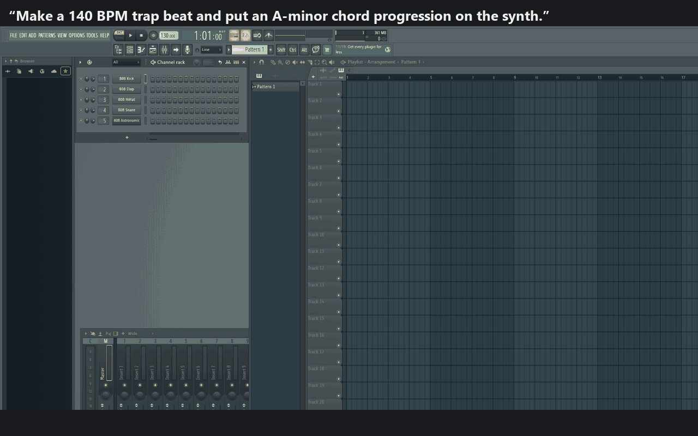

# fLMCP — FL Studio MCP server

<!-- mcp-name: io.github.geezoria/flmcp -->

[](https://github.com/geezoria/FLStudioMCP/actions/workflows/ci.yml)
[](https://pypi.org/project/flmcp-studio/)
[](https://pypi.org/project/flmcp-studio/)
[](LICENSE)

**Let Claude, Cursor, VS Code Copilot, Codex — any [MCP](https://modelcontextprotocol.io)
client — drive FL Studio 2024 / 2025 / 2026.** Transport, patterns, the channel
rack and step sequencer, mixer (including loading effects by name), plugin
parameters, piano-roll note writing,
playlist, arrangements, automation, undo, rendering — plus high-level music
generators, voice-to-MIDI humming and audio-file analysis.



<sub>Recorded on FL Studio 2026 with the tool calls shown below the window; nothing
was clicked by hand.</sub>

- **176 tools, 7 resources, 6 guided prompts**, with MCP tool annotations
  (read-only / destructive) so clients can auto-approve safe calls.
- **Works in FL Studio 2025 and 2026's sandboxed Python.** No sockets or threads
  inside FL — a file transport with an optional MIDI wake-up (see
  [Architecture](#architecture)).
- **One-command setup:** `uvx flmcp-studio install` copies the FL scripts, wires the
  MIDI port and registers the server with your AI apps. `flmcp doctor` tells
  you exactly what is wrong when something is.
- **Mix diagnosis:** `mixer_diagnose` plays the song, holds every track's peak
  and lists clipping, headroom, routing, solo and bypass problems with the
  exact tool call that fixes each one.
- **Toolsets** keep the tool list small for clients with tool limits
  (`FLMCP_TOOLSETS=lean`).

> fLMCP is an independent community project, not affiliated with or endorsed by
> Image-Line.

## Quickstart

Requirements: **Windows 10/11** (macOS works for most tools, see
[platform support](#platform-support)), **FL Studio 2024 or newer** (any
edition with MIDI scripting), and [**uv**](https://docs.astral.sh/uv/) *or*
Python 3.10+.

**1. Install** — close FL Studio first, then:

```powershell
uvx flmcp-studio install
```

This:

1. copies `device_FLStudioMCP.py` into
   `Documents\Image-Line\FL Studio\Settings\Hardware\fLMCP Bridge\` and
   `ComposeWithLLM.pyscript` into `...\Settings\Piano roll scripts\`
   (it reads FL's own *user data folder* setting, so relocated folders work);
2. creates a [loopMIDI](https://www.tobias-erichsen.de/software/loopmidi.html)
   port named `fLMCP` if loopMIDI is installed (recommended, and required on
   FL 2026: it gives the controller script a MIDI input to live on and wakes it
   for every command);
3. on Windows, **with FL closed**, assigns the *fLMCP Bridge* controller to that
   MIDI input in FL's settings and enables it, so there is nothing to click;
4. registers the `flmcp` server with **Claude Desktop, Claude Code, Cursor and
   VS Code** where it finds them (existing configs are backed up to
   `*.flmcp.bak`). Limit it with `--client cursor`, or skip with `--no-clients`.

**2. Start FL Studio.** The bridge loads with FL; `uvx flmcp-studio doctor` should say
*All good*.

If FL was running during the install (FL rewrites its MIDI settings on exit, so
the installer leaves them alone then), either close FL and re-run the install,
or enable the bridge by hand once: `Options → MIDI Settings → Input` → select
the **fLMCP** row (or any MIDI input) → *Controller type* = **fLMCP Bridge** →
make sure the row is enabled.

Piano-roll writing needs no setup on Windows: the server runs the
**ComposeWithLLM** script from the piano roll's *Tools* menu itself, without
taking over the mouse, the keyboard or the window focus. On macOS, run
*Tools → Scripts → ComposeWithLLM* (or `Cmd+Opt+Y` after the first run) when a
tool says the edits are queued.

**3. Restart your AI app and say *"ping FL Studio"*.** If it can't connect:

```powershell
uvx flmcp-studio doctor
```

### Claude Desktop: one-click bundle

Each [release](https://github.com/geezoria/FLStudioMCP/releases) has a
`flmcp-<version>.mcpb` file. Double-click it (or drag it onto *Settings →
Extensions* in Claude Desktop) to add the server without editing any config.
Claude Desktop runs it with uv and lets you pick the tool groups and the
timeout in the extension's settings. You still need the FL side once: close
FL Studio, run `uvx flmcp-studio install --no-clients`, and start FL again. To build
the bundle yourself: `npx @anthropic-ai/mcpb pack mcpb`.

### Other clients / manual config

`uvx flmcp-studio config` prints ready-to-paste snippets for every client. The
canonical entry is:

```json
{
  "mcpServers": {
    "flmcp": { "command": "uvx", "args": ["flmcp-studio"] }
  }
}
```

| Client | Where |
| --- | --- |
| Claude Desktop | `%APPDATA%\Claude\claude_desktop_config.json` → `mcpServers` |
| Claude Code | `claude mcp add --scope user flmcp -- uvx flmcp-studio` |
| Cursor | `~/.cursor/mcp.json` → `mcpServers` |
| VS Code | `%APPDATA%\Code\User\mcp.json` → `servers` (with `"type": "stdio"`) |
| Codex CLI | `~/.codex/config.toml` → `[mcp_servers.flmcp]` `command = "uvx"`, `args = ["flmcp-studio"]` |

Without uv: `pip install flmcp-studio`, then use `"command": "python", "args": ["-m", "fl_studio_mcp"]`
(`flmcp install --command python` writes that for you).

## What you can ask for

> *"Make a new pattern called Verse, put a boom-bap groove on channels 0–2, a
> C-minor octave bassline on channel 3 and an i–VII–VI–V progression on
> channel 4, then play it."*

> *"Give me an overview of the project and tell me which mixer tracks are
> clipping-prone or unrouted."*

> *"Put Fruity Limiter and a reverb on the vocal track, set the reverb to 30 %
> wet and tell me if the master clips while the drop plays."*

> *"I'll hum a riff for 8 seconds — snap it to C minor, quantize to 1/16 at
> 120 BPM and write it into the open piano roll."*

> *"Analyse `C:\samples\break.wav`, detect key and tempo, and flip it into a
> 174 BPM drum & bass loop with the track's own melody on top."*

The built-in **prompts** (*Make a Beat*, *Write a Chord Progression*, *Hum to
Melody*, *Flip Audio to Drum & Bass*, *Review a Mix*, *Project Overview*)
appear in clients that support MCP prompts (e.g. the `/` menu in Claude).

## Tools

| Group | Tools | Highlights |
| --- | :-: | --- |
| `meta` | 6 | ping/health, reconnect, bridge info, API introspection, raw action, toolsets |
| `transport` | 16 | play / stop / record, position, tempo, time signature, metronome, count-in, loop record, overdub |
| `patterns` | 14 | create, rename, clone, clear, color, set length (FL 2026), find by name |
| `channels` | 22 | channel rack, step sequencer get/set, rack swing, routing, note trigger |
| `mixer` | 25 | volume / pan / mute / solo / arm, faders in dB, sends, EQ, **load effects by name**, FX slot on/off and mix, peak meters, **held peaks over playback**, **mix diagnosis** |
| `plugins` | 15 | search installed plugins, parameters get / set / search, **set parameters in real units** ("-6 dB", "2.5 kHz"), presets, editor windows |
| `piano_roll` | 11 | add / read / clear notes, chords, quantize, transpose, humanize |
| `playlist` | 14 | tracks, markers, clip capability report |
| `arrangement` | 5 | list / select arrangements, jump to markers |
| `automation` | 5 | record tempo, channel, mixer and plugin automation |
| `project` | 11 | metadata, save, undo / redo history, render |
| `ui` | 8 | show / hide / focus windows, plugin picker (FL 2026), hints |
| `generators` | 12 | scales, chords, progressions, arpeggios, basslines, melodies, drum styles |
| `voice` | 6 | record + transcribe humming (mono or polyphonic), GUI |
| `audio` | 6 | analyse tempo / key / onsets / melody, slice, DnB flip |

Full reference: [`docs/TOOLS.md`](docs/TOOLS.md).

**Resources** (read without a tool call): `fl://status`, `fl://project`,
`fl://transport`, `fl://channels`, `fl://mixer`, `fl://patterns`,
`fl://playlist`.

**Index conventions** (the server also tells the model this): channel indices
are global and 0-based, pattern numbers are 1-based, mixer track 0 is Master.

### Toolsets

Some clients cap the number of tools (or get worse with 160+ of them). Choose
groups at startup with environment variables:

| Variable | Example | Effect |
| --- | --- | --- |
| `FLMCP_TOOLSETS` | `lean` · `core` · `transport,mixer,piano_roll` | Presets: `all` (default, 176), `lean` (41 composing essentials), `core` (27). Groups can be combined with presets. |
| `FLMCP_DISABLE_TOOLS` | `fl_call_raw,project_render` | Remove individual tools. |
| `FLMCP_USER_DATA_DIR` | `D:\Image-Line` | FL's user data folder, when it isn't found automatically (registry, OneDrive Documents). |
| `FLMCP_BRIDGE_DIR` | | The bridge folder, when it isn't under the user data folder. |

`fl_ping` and `fl_list_toolsets` are always available; `fl_list_toolsets` shows
what is enabled.

```json
"flmcp": { "command": "uvx", "args": ["flmcp-studio"], "env": { "FLMCP_TOOLSETS": "lean" } }
```

## How it compares

There are several FL Studio MCP servers, and each takes a different approach.
This table is based on each project's README as of November 2026. Corrections
are welcome.

| | **fLMCP** | [karl-andres](https://github.com/karl-andres/fl-studio-mcp) | [rosasynthesiz](https://github.com/rosasynthesiz/flstudio-mcp) | [Rtur2003](https://github.com/Rtur2003/FL-MCP) |
| --- | --- | --- | --- | --- |
| Tools | 176 in 15 groups, with toolset presets (`lean` 41, `core` 27) | 61 | 90 | 14 multi-action tools (about 4k tokens) |
| Install | `uvx flmcp-studio install` from PyPI, the MCP Registry, a one-click `.mcpb` for Claude Desktop | from source | from git (the PyPI package is the older v1) | from source, `fl-mcp onboard` |
| Windows MIDI ports | one loopMIDI port, used only to wake the bridge; commands travel as files | loopMIDI | two loopMIDI ports | one loopMIDI port |
| Piano-roll notes | the script runs by itself through window messages, with no manual step | hotkey, after one manual run | run `MCP_Apply` by hand once per session | opt-in desktop macro, or by hand |
| Load effects | by name, through FL's own API (`ui.launchAudioEditor`) | not possible, per its README | suggests; you load them | through UI automation |
| Patterns, playlist, arrangements | create, clone, clear, color, set length, playlist tracks and markers, arrangements | notes and steps only (no pattern tools) | list, select, rename, length | as part of song generation |
| Mix analysis | `mixer_diagnose`, `mixer_peak_watch`, faders in dB, parameters in real units | — | Mix Doctor with more checks, gain staging, reference match, rollback of every change | `fl_mix doctor` / `fix`, BS.1770 loudness, real units |
| Automation recording | ✅ tempo, channel, mixer and plugin | — | — | — |
| Undo | FL's undo history (list, undo, redo) | — | every change reversible, with a rollback log | undo |
| Voice and audio | hum into the mic → MIDI, file analysis, slicing, DnB flip | — | melody, chords and drums to MIDI from audio files | transcription, loudness, spectrum |
| Project files and rendering | save; render through FL's dialog | — | — | writes `.flp` projects, renders from the command line |
| FL versions | 2024, 2025, 2026 (checked live on 26.1) | 20.7+ | 2025+ (tested on 26.1) | 2024+ (checked live on 2025) |
| Tests | offline suite against FL's API stubs; CI on Windows, macOS and Linux with Python 3.10, 3.12 and 3.13 | — | test suite and CI | `fl-mcp selftest`, a fake FL |

Where fLMCP is ahead:

- **Breadth.** It covers the most of FL's scripting API: transport, patterns,
  channel rack, mixer, plugins, piano roll, playlist, arrangements, automation,
  undo, UI and project.
- **No manual steps.** Piano-roll writing works without running a script by
  hand, and effects load by name.
- **Setup.** One PyPI package and one install command, plus `flmcp doctor` for
  when something is wrong.
- **Live humming.** Hum into the microphone and get MIDI.

Where others go further:

- [rosasynthesiz](https://github.com/rosasynthesiz/flstudio-mcp) has a reversible
  change log, reference matching and processing intents.
- [Rtur2003](https://github.com/Rtur2003/FL-MCP) generates `.flp` projects,
  renders, and measures LUFS.
- [CryptoJones](https://github.com/CryptoJones/FL-Studio-MCP-Server) edits `.flp`
  files offline.
- [giang17](https://github.com/giang17/fl-studio-mcp) runs on Linux under Wine.

## Optional extras

Voice-to-MIDI and audio analysis need heavier libraries (numpy, librosa,
sounddevice…). The core server never imports them; the tools return an install
hint until they are present.

```powershell
uvx --from "flmcp-studio[audio,gui]" flmcp install   # or: pip install "flmcp-studio[audio,gui]"
```

**Polyphonic transcription** (`polyphonic=True`: chords, strums, full mixes via
Spotify Basic Pitch on the ONNX runtime):

```powershell
pip install "flmcp-studio[polyphonic]"
pip install basic-pitch --no-deps   # its metadata pins a TensorFlow that has no 3.12 build
```

MP3 decoding needs `ffmpeg` on `PATH`.

## Architecture

```
 AI app ──stdio──► flmcp server ──writes──► mcp_command.json ─┐
   ▲                   │                                       │  FL Studio
   │                   └─(optional) MIDI CC wake via loopMIDI ─┤  device_FLStudioMCP.py
   │                                                           │  OnIdle / OnMidiMsg
   └──────────── result ◄── mcp_response.json ◄── executes FL API on FL's main thread
                            mcp_heartbeat.json (≈1 s, liveness + versions)

 Piano roll:  server stages fLMCP_request.json → Tools menu → ComposeWithLLM.pyscript
              edits notes through flpianoroll → writes fLMCP_state.json
```

- **Why files?** FL Studio 2025+ runs controller scripts in a sandboxed
  interpreter: no sockets, no threads, unreliable `os` file operations — but
  `open()` works. The bridge reads a command file when FL calls it back and
  writes the response. Commands carry a protocol version and unique id,
  stale commands from an earlier session are ignored, and calls are serialized
  with a cross-process lock.
- **Why MIDI wake?** A CC 119 message on channel 16 sent to the `fLMCP`
  loopMIDI port triggers `OnMidiMsg` immediately, so round-trips stay in the
  tens of milliseconds (median ≈ 40 ms measured on FL 2026). FL 2026 does not
  call the script's `OnIdle` at all in our tests, so there **the wake port is
  required**, not just faster.
- **Why a piano-roll script?** `flpianoroll` (the only API that adds/removes
  notes) exists only inside piano-roll scripts, so the server stages a request
  and triggers the script with FL's script hotkey.

Details: [`docs/ARCHITECTURE.md`](docs/ARCHITECTURE.md) · what FL's API can't do:
[`docs/LIMITATIONS.md`](docs/LIMITATIONS.md) · FL 2026 API changes:
[`docs/FL_API_2026.md`](docs/FL_API_2026.md).

## Platform support

| | Windows | macOS |
| --- | :-: | :-: |
| Controller bridge (transport, mixer, channels, plugins…) | ✅ | ✅ (set `FLMCP_BRIDGE_DIR` if auto-detection fails) |
| MIDI wake (required on FL 2026) | ✅ loopMIDI | ❌ not yet: relies on `OnIdle`, which FL 2026 did not call on Windows (untested on macOS) |
| `flmcp install` client registration | ✅ | ✅ |
| Automatic controller assignment | ✅ | manual |
| Piano-roll writing (script runs automatically) | ✅ | manual: *Tools → Scripts → ComposeWithLLM* |
| Voice / audio tools | ✅ | ✅ |

## Troubleshooting

Run `flmcp doctor` first — it checks the installed scripts (and whether they
are outdated), the MIDI port and controller assignment, whether FL is running,
the bridge heartbeat, a live ping and version mismatches.

| Symptom | Fix |
| --- | --- |
| `bridge offline` / no heartbeat | FL isn't running or the controller isn't enabled. Close FL and re-run `uvx flmcp-studio install`, or set it by hand: *Options → MIDI Settings → Input*, Controller type **fLMCP Bridge**. Check *View → Script output* for `[fLMCP]` lines. |
| Calls time out or run twice | Doctor warns about several FL instances: they share the bridge folder and race for commands. Close all but one. |
| Calls time out while FL shows a dialog | A modal dialog (save prompt, plugin error, "Confirm") blocks FL's UI thread and the bridge with it. Close the dialog. |
| Doctor says the script is outdated | `uvx flmcp-studio install`, then restart FL (or *MIDI Settings → Update scripts*). |
| Commands are slow (~0.5–1 s) | Install loopMIDI and re-run `flmcp install` so the MIDI wake port exists. |
| Piano-roll edits don't apply | Pass `channel` so the tool opens that piano roll, and close any FL dialog. The result's `note` says why the script didn't run. As a last resort run *Tools → Scripts → ComposeWithLLM* in the piano roll yourself. |
| `playlist_place_pattern` returns an error | FL's API doesn't expose clip placement — see [`docs/LIMITATIONS.md`](docs/LIMITATIONS.md). |
| `voice_*` / `audio_*` say a module is missing | Install the `[audio]` extra. |
| Upgrading from 0.3 (`fl-studio-mcp`) | `uvx flmcp-studio install` replaces the old `fl-studio-mcp` client entries and the old TCP bridge script. |

## Development

```bash
git clone https://github.com/geezoria/FLStudioMCP.git && cd FLStudioMCP
python -m venv .venv && .venv/Scripts/activate      # source .venv/bin/activate on macOS
pip install -e ".[dev]"
pytest && ruff check .
python -m fl_studio_mcp install --command python    # copy your working-tree bridge into FL
```

The test suite runs offline: the bridge transport is faked and the FL-side
script is imported against the official FL API stubs. See
[`CONTRIBUTING.md`](CONTRIBUTING.md) and [`AGENTS.md`](AGENTS.md).

## Credits

Earlier community projects that showed the way:
[karl-andres/fl-studio-mcp](https://github.com/karl-andres/fl-studio-mcp),
[ohhalim/flstudio-mcp](https://github.com/ohhalim/flstudio-mcp),
[veenastudio/flstudio-mcp](https://github.com/veenastudio/flstudio-mcp).
Contributors are listed in [`CHANGELOG.md`](CHANGELOG.md).

MIT licensed — see [`LICENSE`](LICENSE).
